<div align="center">


# Design Studio

**Describe an app. Answer a few questions. Get a designed, responsive, clickable screen set.**<br>
A local AI design studio that lives inside Claude Code.

[](LICENSE)


<br>

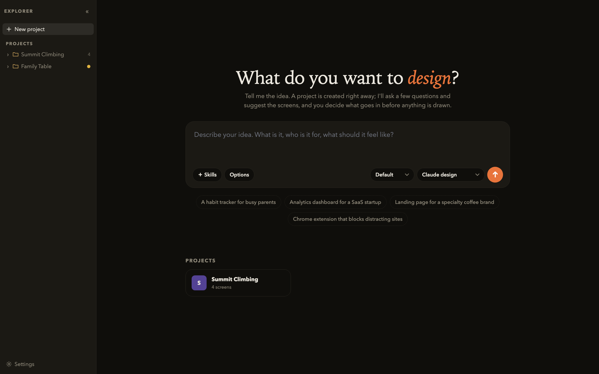

</div>

<br>

| **~90x** | **$0.002** | **0** | **100%** |
|:---:|:---:|:---:|:---:|
| cheaper per screen than a default Claude Code call | to draw one screen in economy mode | dependencies, no build step | local: your files, your machine |

<br>

Design Studio is a Figma-style canvas that runs on `localhost`. You write the idea in plain language; Claude asks the few questions that actually change the design, proposes the screens, and only then draws them. Everything is plain HTML and CSS you can open, edit, or hand to a developer. No account, no cloud, no build step.

## Watch it

[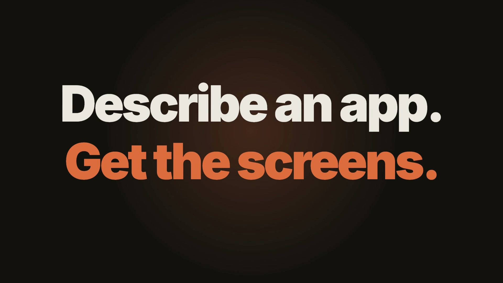](docs/demo.mp4)

## Highlights

| | |
|---|---|
| **Idea in, project out** | Submit an idea and a project appears at once, named by Claude. Its questions and progress live on the server, so switching tabs or reloading never loses them. |
| **Questions that matter** | 3 to 4 idea-specific, multi-select questions plus platform. Pick Mobile and it asks which phone (iPhone, Pixel, Samsung) and designs in iOS or Material conventions accordingly. |
| **You approve the screens** | Rename, remove, or add screens before anything is drawn. It designs exactly that list. |
| **Responsive web** | Web projects are built fluid. Preview Mobile 390, Tablet 820, Laptop 1280 and Desktop 1440 with one click. |
| **Clickable prototype** | Play the flow like the real thing. Buttons, tabs and cards navigate by built-in links, hotspots you draw, or by matching their label to a screen name. |
| **Variants** | Ask for three alternative takes on any screen, compare them next to the original, keep one. The original is saved to `history/`. |
| **Design system, editable live** | Every project gets a CSS design system. Change a token and every screen updates. |
| **Cheap by design** | Economy mode (default) draws on a small model with lean calls and three screens per call: about **$0.002 per screen** in my measurements, roughly 90x less than a default Claude Code call per screen. Every project shows its measured cost. |
| **Design sources (MCP)** | Connect Mobbin, Figma, Canva, Subframe, Playwright (screenshots of Dribbble, Awwwards, Behance...) or your own MCP server, and choose which ones a project uses. Research mode also searches the galleries directly. |
| **Bring your skills** | Plug in installed Claude skills (impeccable, frontend-design, ui-ux-pro-max, taste-skill and more). Recommended UI skills are added automatically when installed. |

## Screenshots

<table>
<tr>
<td width="50%">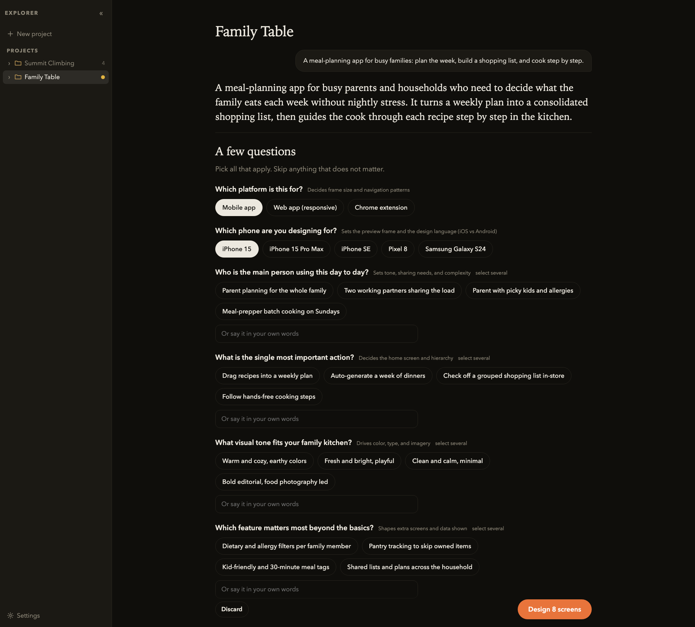<br><sub><b>Questions and an editable screen list.</b> Multi-select, platform and phone, then you decide what gets drawn.</sub></td>
<td width="50%">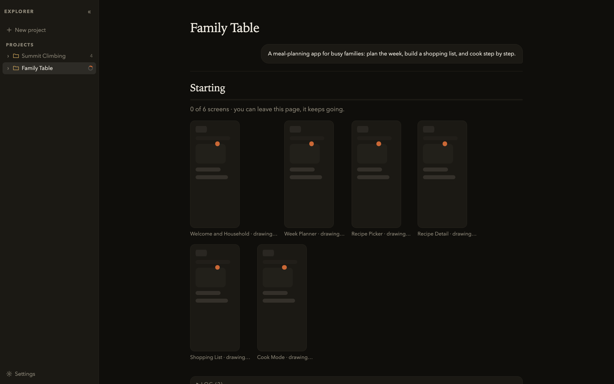<br><sub><b>Screens sketch themselves,</b> then become live thumbnails. Leave the page any time, it keeps going.</sub></td>
</tr>
<tr>
<td>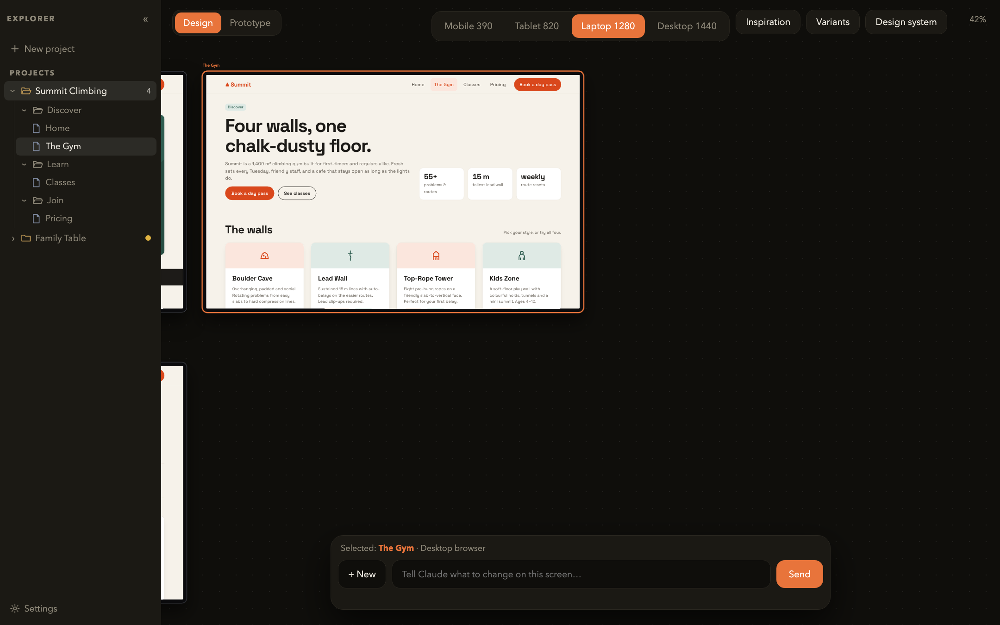<br><sub><b>An explorer-style sidebar.</b> Projects are folders; sections and screens expand like a file tree.</sub></td>
<td>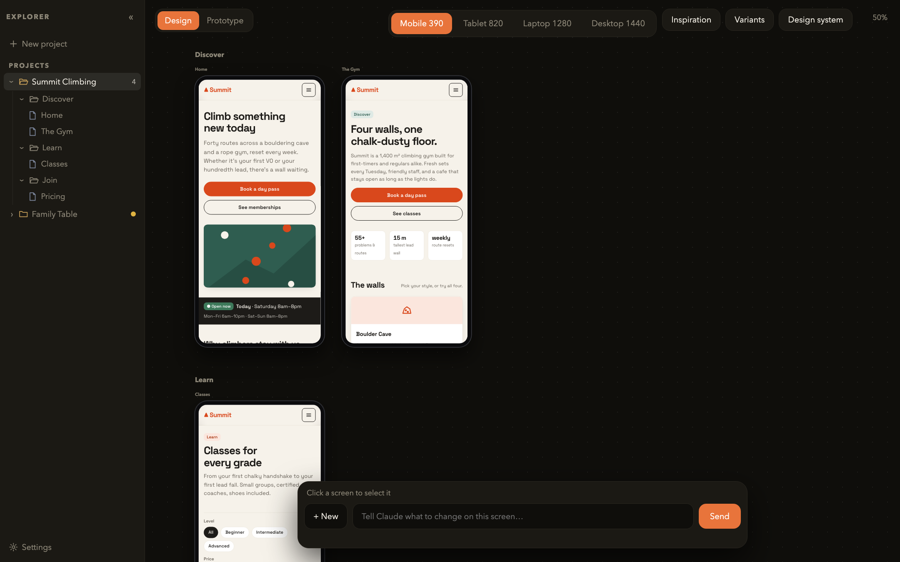<br><sub><b>Responsive by default.</b> The same site at Mobile 390, with a working menu.</sub></td>
</tr>
<tr>
<td>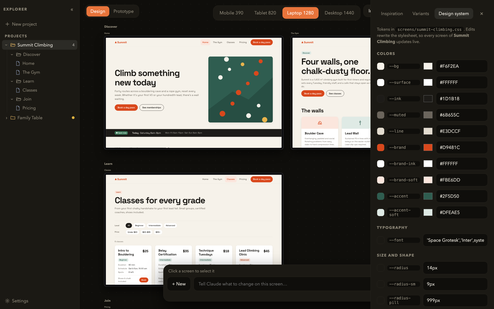<br><sub><b>Design system panel.</b> Edit colors, fonts and sizes; every screen updates live.</sub></td>
<td>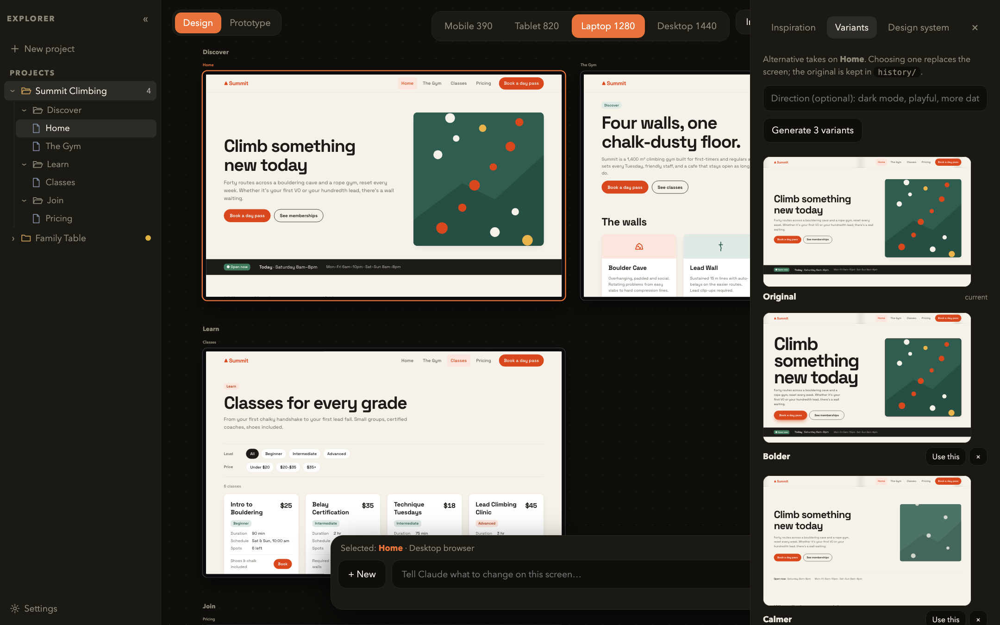<br><sub><b>Variants.</b> Bolder, Calmer, New layout, or a direction you type.</sub></td>
</tr>
<tr>
<td>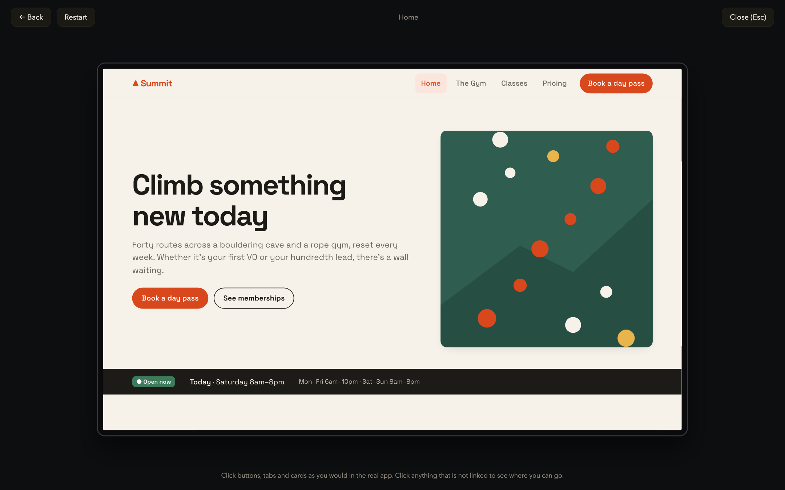<br><sub><b>Prototype player.</b> Click real buttons and tabs to move through the flow.</sub></td>
<td>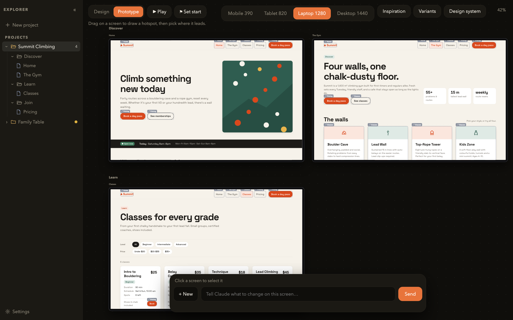<br><sub><b>Prototype mode.</b> Links found in the design show as dashed boxes; draw your own hotspots.</sub></td>
</tr>
<tr>
<td colspan="2">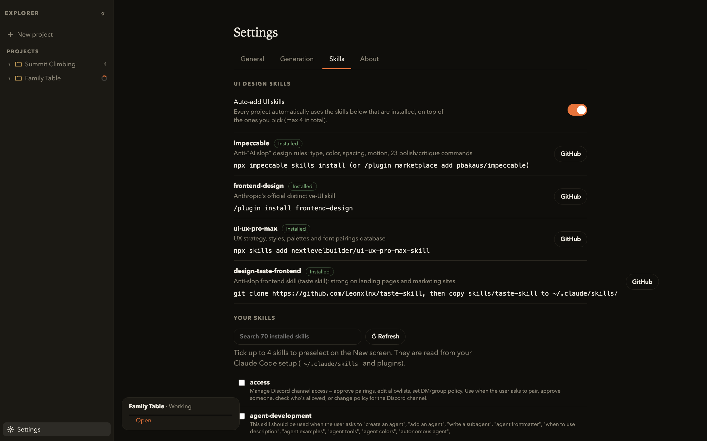<br><sub><b>Settings.</b> Model, mode, parallelism, web access, and auto-added UI skills.</sub></td>
</tr>
</table>

## Install

You need **Node.js 16.7+** (18+ recommended), **git**, and the **[Claude Code](https://docs.claude.com/en/docs/claude-code) CLI** (`claude` on your `PATH`, signed in). The studio uses it to do the designing; there are no API keys to configure.

```bash
npx skills add jxngrx/design-studio
```

That installs the `/design-studio` skill. Restart Claude Code, run `/design-studio`, and say yes when it offers to set up the local app in `~/.design-studio` (a one-time download).

<details>
<summary>Other ways to install</summary>

**Shell installer** (skill and app in one step)

```bash
curl -fsSL https://raw.githubusercontent.com/jxngrx/design-studio/main/install.sh | bash
```

**Claude Code plugin marketplace**

```text
/plugin marketplace add jxngrx/design-studio
/plugin install design-studio@design-studio
```

**Manual**

```bash
git clone https://github.com/jxngrx/design-studio.git ~/.design-studio
mkdir -p ~/.claude/skills/design-studio
cp ~/.design-studio/skills/design-studio/SKILL.md ~/.claude/skills/design-studio/
```

**Update:** run the install command again (it pulls the latest). **Uninstall:** delete `~/.design-studio` and `~/.claude/skills/design-studio`.

</details>

## Use it

**From Claude Code.** Type `/design-studio`, or just say what you want:

> Design a meal-planning app for busy families.

Claude starts the studio, opens `http://localhost:4400`, and your idea lands on the analysis screen. If you already described the project in chat, it opens with the idea filled in.

**On its own.**

```bash
cd ~/.design-studio && node server.mjs      # then open http://localhost:4400
```

### The flow

1. **Describe** the idea on the New screen. Pick a model, a mode (*Claude design* or *Research and design*), and optional skills.
2. **Answer** the questions. Choose a platform; for mobile, choose the phone.
3. **Edit the screen list.** Rename, remove, add.
4. **Watch** the screens draw. Open the canvas any time.
5. **Refine.** Click a screen and tell Claude what to change, generate variants, edit the design system, or play the prototype.

### Deep links

Handy for bookmarks and scripts.

```text
#new                       the New screen
#settings?tab=skills       a settings tab
#p/<Project>?vp=mobile     a project at a viewport (mobile, tablet, laptop, desktop)
  &panel=ds|insp|var       open a side panel
  &mode=proto              prototype mode
  &play=<screen id>        open the player on a screen
  &select=<id>&zoom=0.4    select a screen, set the zoom
```

## Recommended skills

Design Studio works on its own and gets better with UI skills installed. Turn on **Settings, Skills, Auto-add UI skills** and any of these that are installed are used on every project (4 skills maximum per run).

| Skill | Repository | Good at |
|---|---|---|
| impeccable | [pbakaus/impeccable](https://github.com/pbakaus/impeccable) | Avoiding generic "AI slop": type, color, spacing, motion |
| frontend-design | [anthropics/claude-code](https://github.com/anthropics/claude-code/tree/main/plugins/frontend-design) | Anthropic's official distinctive-UI guidance |
| ui-ux-pro-max | [nextlevelbuilder/ui-ux-pro-max-skill](https://github.com/nextlevelbuilder/ui-ux-pro-max-skill) | Styles, palettes, font pairings, UX rules |
| taste-skill | [Leonxlnx/taste-skill](https://github.com/Leonxlnx/taste-skill) | Polished marketing and landing pages |

Read a skill before installing it; skills are instructions your agent will follow.

## Design sources and references

Each project has an **Inspiration** panel for links and images that Claude uses whenever it designs or edits that project, plus a **Design sources (MCP)** section.

- **Connect sources** in Settings, Connections (or from the Inspiration panel): Mobbin, Figma, Canva, Subframe, Playwright, Context7, shadcn, or a **custom MCP server** (HTTP, SSE, or a local command). Servers are added through the `claude` CLI, so they are the same ones Claude Code uses. Servers that need a sign-in are authorized once with `/mcp` in Claude Code.
- **Choose per project** with **+ MCP** in the first chat box. Selecting any makes the project research first: Claude pulls real screens and flows from those sources and writes style notes the screens follow.
- **Cost note:** user-added MCP servers are loaded alone, so calls stay lean. Claude.ai connectors cannot be isolated, so a research step that uses one carries all of that connector's tools and costs more.
- **No MCP?** Research mode still searches Mobbin, Dribbble, Behance, Awwwards and Land-book through web search, and you can paste pages under *Pages to read first*. The studio reads page text, not images, so MCP sources or screenshots give richer inspiration.

## What it costs

> **Short version:** a default Claude Code call spends about **$0.19** on one screen, mostly on ~140K tokens of overhead. Design Studio's economy mode spends about **$0.002**.

Design Studio runs on your own Claude Code login, so usage counts against your plan (or API billing). A normal `claude` call carries about 140K tokens of overhead (system prompt, hooks, skills, connector tools), which is most of the price of a screen. **Economy mode** removes it: a short system prompt, only the tools needed, no hooks or connectors, a small model on low effort for drawing, three screens per call, and terse markup that reuses the design system.

### Measured

Real numbers from Claude's own usage reports, one screen of the same size, one machine (yours will differ):

| One screen | Cost | vs default call |
|---|---:|---|
| Default Claude Code call (Sonnet 5.5) | **$0.186** | `██████████████████████████████` |
| Lean call, same model | $0.096 | `███████████████` |
| Lean call, Haiku 5.5 | $0.005 | `▏` 35x cheaper |
| Lean, Haiku, 3 screens per call | **$0.002** | `▏` **~90x cheaper** |
| Whole 3-screen project, plan + design system + screens, all Haiku | **$0.018** | |

### Estimated against Claude.ai artifacts

I did **not** measure artifacts. This estimate prices a Sonnet-drawn artifact page like the "lean call, same model" row above ($0.096 per screen), because a chat turn also has little overhead. On a Claude.ai plan, artifacts use your plan limits rather than dollars, so treat this as a token-cost comparison, not a bill.

| Job | Design Studio (economy) | Same screens as Sonnet artifacts | Roughly |
|---|---:|---:|---|
| 1 screen | $0.002 | $0.096 | **~45x cheaper** |
| 3-screen project (measured) | $0.018 | ~$0.29 | **~16x cheaper** |
| 9-screen project (calculated) | ~$0.03 | ~$0.86 | **~29x cheaper** |

Whole projects save less than single screens because planning and the design system are paid once on top. The model does most of the work here: Haiku is much cheaper than Sonnet, and plain Haiku in a chat would be cheap too. What Design Studio adds is the multi-screen flow, consistency, variants and prototype in one pass. A single artifact on a stronger model can look richer than Haiku; raise **Planning model** in Settings, Generation if you want better plans, or turn Economy mode off for the full-power flow.

### Design Studio or an artifact?

| | Claude artifact | Design Studio |
|---|---|---|
| One page, quick | Best choice | Overkill |
| A whole app or site flow | Many manual turns | One pass, consistent |
| Shared design system and header | You re-prompt for it | Built in |
| Variants, prototype, responsive preview | No | Yes |
| Your files | Hosted by Claude | Local HTML you own |
| Shareable link | Yes | Not yet |
| Cost visible per project | No | Yes |
| Setup | None | One command |

Every project shows its measured cost on its page, and Settings shows the total spent.

## How it works

```text
browser (index.html + ui/*.js)  <->  server.mjs (127.0.0.1:4400)  ->  claude -p (your Claude Code login)
                                          |
                      screens.json  projects.json  settings.json  proto.json  screens/*.html  refs/  history/
```

- **No build step, no dependencies.** A single Node file serves static files and a small JSON API; the UI is plain JavaScript.
- **Each screen is one HTML file** in `screens/`, linked to its project's design system stylesheet. Open them in any browser or editor.
- **Projects are state machines** on the server: `analyzing`, `brief`, `generating`, `ready`, `partial`, `error`. Questions, edits and logs survive reloads.
- **Failures are visible.** Every step is logged, each screen retries once automatically, and failed screens show the reason with a one-click retry.

<details>
<summary>Repository layout</summary>

```text
server.mjs              server + AI pipeline (analysis, planning, drawing, variants, tokens, prototype)
index.html              canvas and frame rendering
ui/                     sidebar, New screen, project page, panels, prototype, settings, viewports
skills/design-studio/   the Claude skill (SKILL.md)
scripts/                export.sh builds a clean shareable copy
examples/seed/          the example project created on first run (release builds)
install.sh              one-command installer
docs/                   logo and screenshots
```

</details>

## Privacy and safety

- Everything runs on your machine. The server listens on `127.0.0.1` only and rejects requests from other hosts and other sites.
- Your designs, references and settings stay in the install folder. Nothing is uploaded by Design Studio itself.
- It calls the `claude` CLI, so prompts (your idea, answers, reference content) go to Anthropic under your own Claude account, like any Claude Code session.
- Web research is optional and can be turned off in Settings. Fetched page text is treated as data, never as instructions.
- Claude runs with the studio folder as its working directory and is allowed to read, edit and write files there (plus fetch web pages when web access is on). Review a skill before you enable it.

## Troubleshooting

| Problem | Fix |
|---|---|
| "Could not reach the studio server" | Start it: `cd ~/.design-studio && node server.mjs` |
| Nothing is generated or every step fails | Check `claude --version` and that you are signed in. Failed screens list their reason; use **Retry failed screens**. |
| Port 4400 is busy | `PORT=4500 node server.mjs` |
| Generation is slow or expensive | Keep Economy mode on, lower **Parallel screens**, and avoid claude.ai connectors in research. |
| A skill is missing from the list | Install it, then press **Refresh** in the skills picker. |

## Roadmap

Versions with undo, export to code (HTML bundle, React with Tailwind), share links, and a one-click critique pass are next. Ideas and pull requests are welcome.

## License

[MIT](LICENSE)
